# VLC Web Remote

Interface web responsiva para controlar o VLC pela rede local. O app roda em Node.js, serve uma tela mobile-first e faz proxy local para a interface HTTP do VLC. O visual segue o mesmo tema retro SNES do controle fisico.

| Player | Volume | Faixas | VLC fechado |
| --- | --- | --- | --- |
| 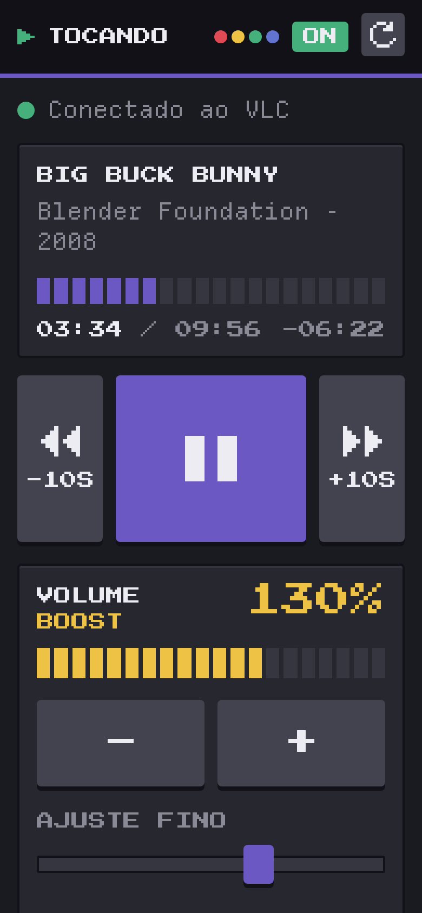 | 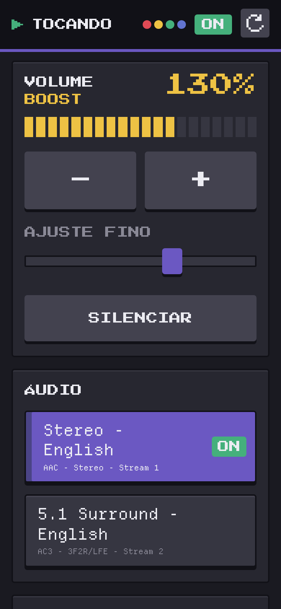 | 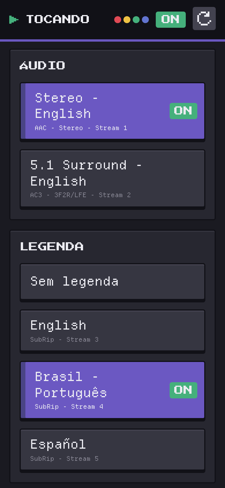 | 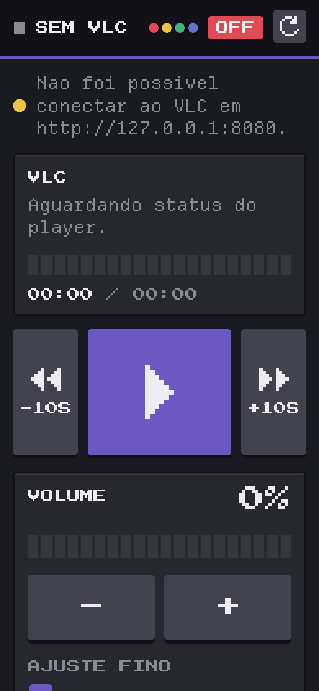 |

## Recursos

- Pausar e reproduzir o video atual.
- Avancar e voltar 10 segundos.
- Aumentar, diminuir, silenciar e ajustar volume ate 200%.
- Selecionar faixas de audio e legendas.
- Acessar pelo celular usando o endereco da rede local.
- Abrir videos pelo menu grafico com o VLC ja iniciado com HTTP ativo.
- Controle fisico com knob: ESP32-C3 + tela de 2.4" em estilo retro SNES (veja abaixo), que controla o VLC ou, por Bluetooth, qualquer computador ou celular sem servidor (volume, mudo, brilho, play/pause, proxima/anterior).

## Requisitos

- Node.js 18 ou superior.
- VLC instalado no computador que vai tocar o video.
- iPhone/celular e computador na mesma rede Wi-Fi.
- Controle fisico (opcional): ESP32-C3 Super Mini, modulo de tela ST7789 2.4" com encoder EC11 e [PlatformIO](https://platformio.org/). Detalhes em [firmware/README.md](firmware/README.md).

## Como Rodar

Crie a configuracao local:

```bash
cp .env.example .env
```

Edite `.env` se quiser trocar a senha padrao `vlc`. Use a mesma senha no VLC em `Ferramentas > Preferencias > Tudo > Interface > Interfaces principais > Lua > Lua HTTP`.

Inicie o VLC com HTTP ativo:

```bash
./scripts/start-vlc.sh
```

Em outro terminal, inicie o controle web:

```bash
npm start
```

Abra no celular o endereco mostrado como `Rede local`, por exemplo:

```text
http://192.168.0.10:3000
```

## Desenvolvimento

```bash
npm run dev
npm test
```

`npm run dev` usa `node --watch src/server.js` para reiniciar o servidor ao alterar arquivos do backend. `npm test` roda os testes com `node:test`. O frontend fica em `public/` e nao precisa de build.

## Configuracao

| Variavel | Padrao | Uso |
| --- | --- | --- |
| `PORT` | `3000` | Porta da interface web |
| `HOST` | `0.0.0.0` | Endereco de escuta do servidor |
| `VLC_PROTOCOL` | `http` | Protocolo do VLC |
| `VLC_HOST` | `127.0.0.1` | Host onde o VLC esta rodando |
| `VLC_PORT` | `8080` | Porta HTTP do VLC |
| `VLC_PASSWORD` | `vlc` | Senha Lua HTTP configurada no VLC |
| `VLC_VOLUME_STEP` | `32` | Passo dos botoes de volume |
| `VLC_FORCE_SOFTWARE_GL` | `0` | Use `1` se o VLC falhar com erro de OpenGL/Mesa |

Tambem e possivel sobrescrever valores ao iniciar:

```bash
VLC_HOST=192.168.0.20 VLC_PASSWORD=sua_senha npm start
```

## Abrir Videos pelo Menu Grafico

Para instalar a entrada `Abrir com VLC` usando o script do projeto:

```bash
./scripts/install-open-with-vlc.sh
```

Depois disso, videos abertos pelo gerenciador de arquivos iniciam o VLC com a interface HTTP ativa.

## Controle Fisico (ESP32-C3 + Knob)

Um controle de mesa com tela retro estilo SNES: ESP32-C3 Super Mini, tela ST7789 de 2.4" (320x240) e encoder EC11. Ao ligar, ele pergunta o que controlar (a ultima escolha ja vem marcada):

- **VLC**: o VLC deste computador, por Wi-Fi, atraves deste servidor (`/api/status` e `/api/control`). A senha do VLC nunca vai para o dispositivo.
- **BT**: qualquer computador ou celular, sem servidor e sem Wi-Fi. O knob vira um controle de midia Bluetooth (volume, mudo, brilho, play/pause, proxima e anterior). Pareie uma vez em Bluetooth > Adicionar dispositivo > `VLC Knob`; depois ele reconecta sozinho.

| Escolha do modo | Modo VLC | Modo BT |
| --- | --- | --- |
| 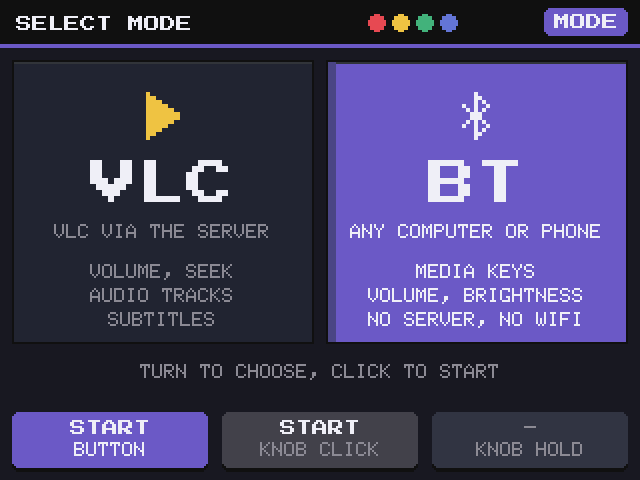 | 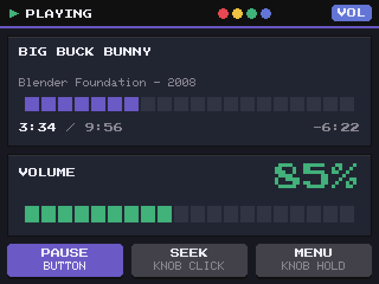 | 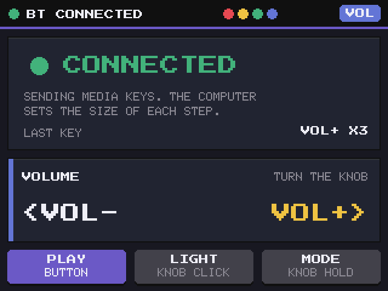 |

Para montar: ligacoes em [docs/wiring/esp32c3-tft-ec11.png](docs/wiring/esp32c3-tft-ec11.png); compilar, gravar e configurar o Wi-Fi em [firmware/README.md](firmware/README.md).

Para trocar de modo depois: no modo VLC, menu > MODE; no modo BT ou em qualquer tela de erro, segure o knob. Trocar entre VLC e BT reinicia o knob direto no modo novo.

### Modo VLC

| Controle | Tela inicial | Modo seek | Menu |
| --- | --- | --- | --- |
| Girar o knob | Volume | Pula 10/30/60 s | Navega |
| Clicar o knob | Entra no modo seek | Volta ao volume | Seleciona |
| Segurar o knob | Abre o menu | Abre o menu | Fecha |
| Botao K0 | Play/pause | Play/pause | Volta |
| Segurar K0 | Mudo | Mudo | Fecha |

O menu tem AUDIO, SUBTITLES (legendas) e MODE. Precisa do `npm start` rodando e do VLC aberto com `./scripts/start-vlc.sh`; se faltar algum, a tela diz qual.

| Tela inicial | Volume acima de 100% |
| --- | --- |
|  | 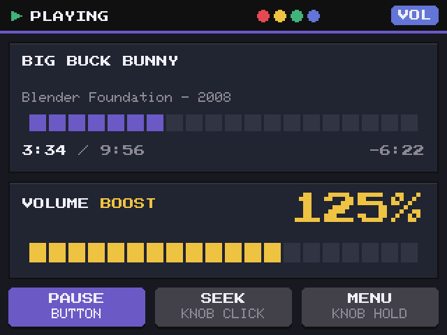 |
| **Modo seek** | **Menu** |
| 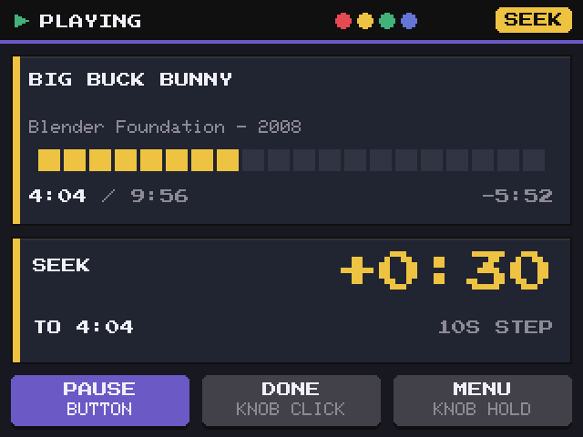 | 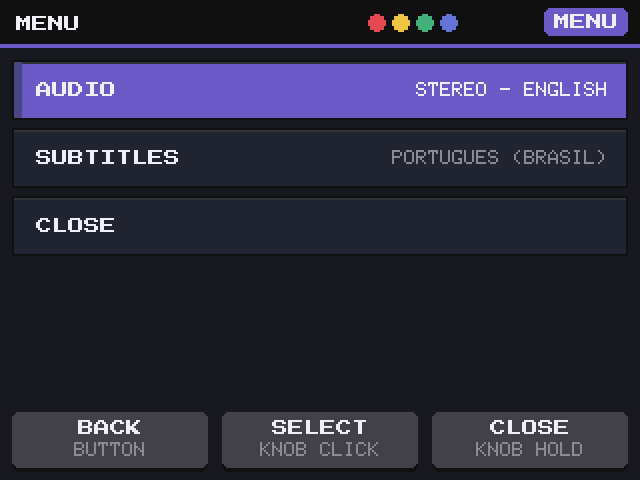 |
| **Faixas de audio** | **Legendas** |
| 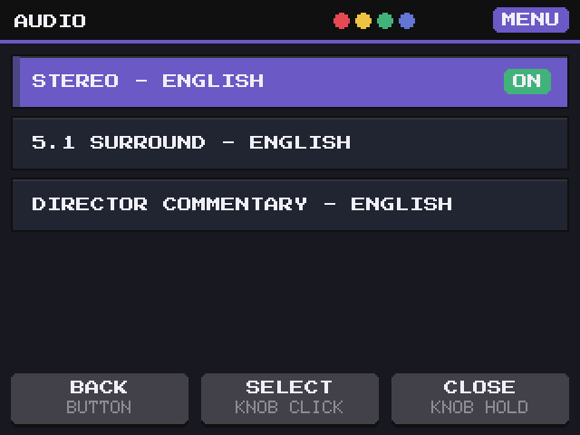 | 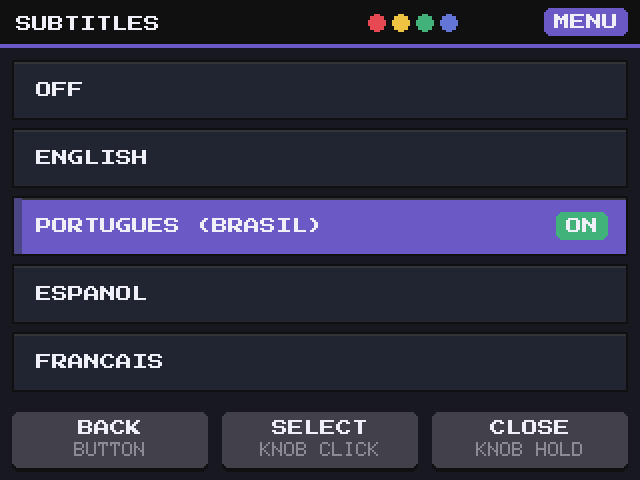 |
| **VLC fechado** | **Servidor fora do ar** |
| 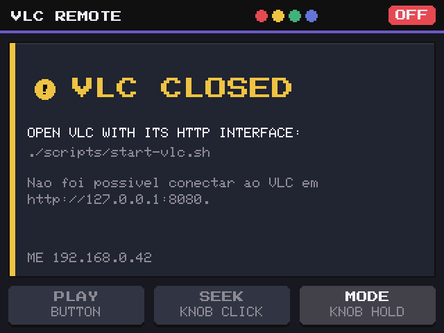 | 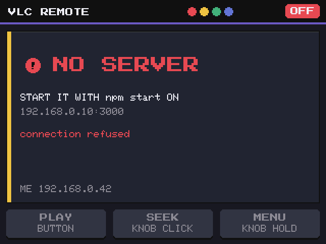 |

### Modo BT

| Controle | Acao |
| --- | --- |
| Girar o knob | Uma tecla por clique do knob: volume +/-, brilho +/- ou faixa (esquerda = anterior, direita = proxima) |
| Clicar o knob | Troca o alvo: VOL, LIGHT, TRACK (volta para VOL depois de 5 s parado) |
| Segurar o knob | Volta para a escolha do modo |
| Botao K0 | Play/pause |
| Segurar K0 | Mudo |

As teclas so vao do knob para o computador, entao a tela mostra a ultima tecla enviada, nao o volume nem o titulo. O tamanho de cada passo de volume e o sistema que define (2% no Windows, cerca de 6% no macOS, 5% no KDE). As teclas de brilho funcionam no Linux e na maioria dos notebooks; monitores externos costumam ignorar.

| Pareando | Conectado |
| --- | --- |
| 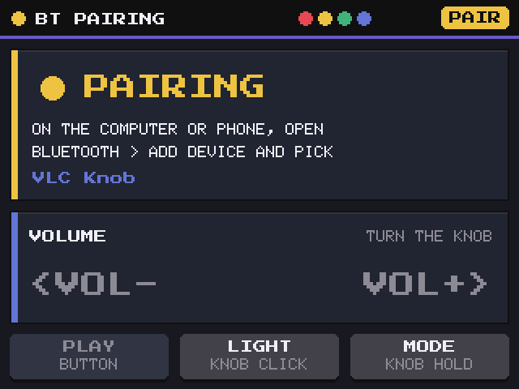 |  |

As imagens acima sao capturas reais da tela, feitas com `firmware/tools/screenshot.py` em modo demo.

## Estrutura

```text
src/                 Servidor Node.js e cliente da API do VLC
public/              HTML, CSS e JavaScript da interface
public/fonts/        Fontes pixel Press Start 2P e Departure Mono (licenca OFL)
scripts/             Automacoes para iniciar e integrar o VLC
docs/                Guias e imagens do projeto
docs/vlc-setup.md    Passo a passo detalhado de configuracao do VLC
docs/wiring/         Ligacoes do controle fisico (ESP32-C3 + tela + knob)
firmware/            Firmware PlatformIO do controle fisico (modos VLC e BT)
```

## Seguranca

Nao publique `.env` nem senhas reais. O projeto ja ignora `.env`, `node_modules/`, logs e arquivos temporarios de automacao. Se for expor fora da rede local, coloque autenticacao e HTTPS na frente do servidor.

## Solucao de Problemas

- Confira se VLC e celular estao na mesma rede.
- Confirme se o VLC esta aberto com a interface Web habilitada.
- Verifique se `VLC_PASSWORD` e igual a senha Lua HTTP do VLC.
- Consulte [docs/vlc-setup.md](docs/vlc-setup.md) para setup detalhado.
