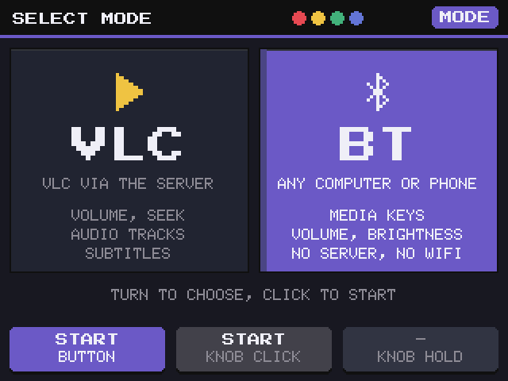
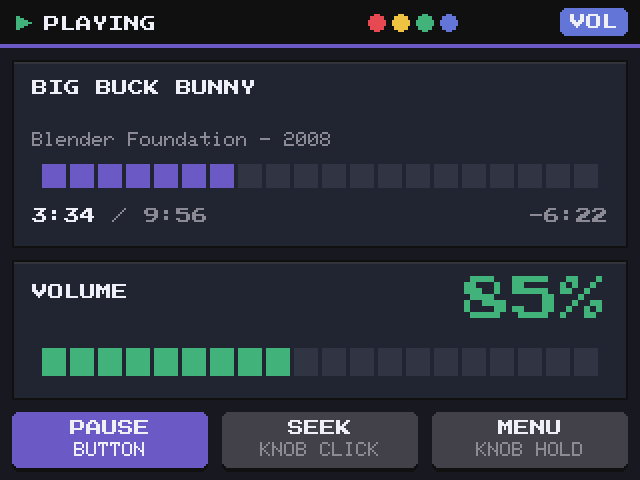
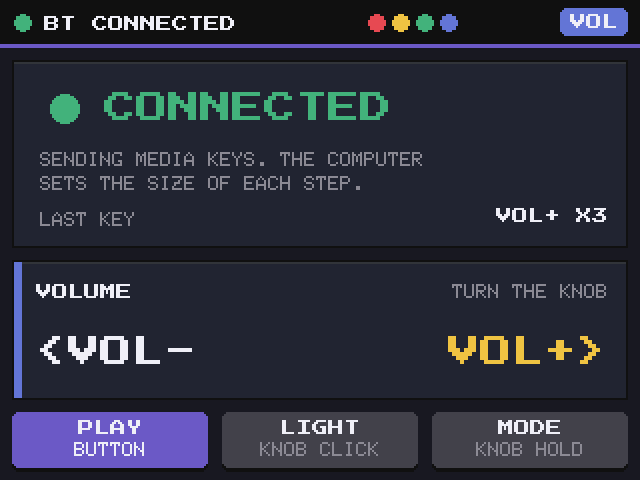
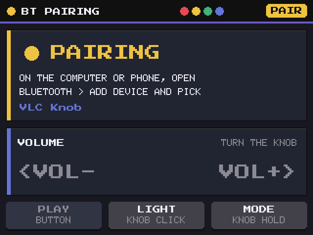

# Firmware do Controle Fisico

Controle retro (SNES escuro) para o VLC ou, por Bluetooth, para qualquer
computador ou celular: ESP32-C3 Super Mini + tela ST7789 de 2.4" (320x240) +
encoder EC11. No modo VLC ele conversa com o servidor deste repo por Wi-Fi,
nunca direto com o VLC, entao a senha do VLC fica so no computador.

| Escolha do modo | Modo VLC | Modo BT |
| --- | --- | --- |
|  |  |  |

Ligacoes: [../docs/wiring/esp32c3-tft-ec11.png](../docs/wiring/esp32c3-tft-ec11.png)
(alimente o modulo pelo 3V3, nao pelo 5V).

## Escolha do Modo

Ao ligar, a tela pergunta o que controlar. Gire o knob para escolher e clique
o knob (ou K0) para comecar. A ultima escolha fica salva na flash e ja vem
marcada no proximo boot.

- **VLC** usa `/api/status` e `/api/control`.
- **BT** nao usa servidor nem Wi-Fi: o knob vira um controle de midia
  Bluetooth LE (HID consumer control) chamado `VLC Knob`.

Para trocar depois: no modo VLC, menu > MODE; no modo BT, segure o knob; nas
telas de erro, segure o knob. Trocar entre BT e VLC reinicia a placa direto no
modo novo (salvo na flash como `auto`), para os dois radios nunca rodarem
juntos.

## Modo BT

Pareie uma vez: no computador ou celular, Bluetooth > Adicionar dispositivo >
`VLC Knob` (sem PIN). O pareamento fica salvo nos dois lados e o knob
reconecta sozinho quando o modo BT comeca. Testado no Linux (KDE): aparece
como teclado e volume e brilho respondem.

| Controle | Acao |
| --- | --- |
| Girar o knob | Uma tecla por clique do knob: volume +/-, brilho +/- ou faixa (esquerda = anterior, direita = proxima) |
| Clicar o knob | Troca o alvo: VOL, LIGHT, TRACK (volta para VOL depois de 5 s parado) |
| Segurar o knob | Volta para a escolha do modo |
| Botao K0 | Play/pause |
| Segurar K0 | Mudo |

| Pareando | Conectado |
| --- | --- |
|  |  |

As teclas so vao num sentido: a tela mostra a ultima tecla enviada (e quantas
vezes seguidas), nao o nivel do volume nem o titulo. Cada clique do knob e um
passo do sistema (2% no Windows, cerca de 6% no macOS, 5% no KDE). Brilho:
funciona no Linux e na maioria dos notebooks; Windows e macOS variam e
monitores externos costumam ignorar.

Se o computador nao reconectar: remova `VLC Knob` da lista de Bluetooth dele
e pareie de novo. O knob guarda os pareamentos na flash (sobrevivem a um
`pio run -t upload`); para apagar todos, e tambem o modo salvo, rode
`pio run -t erase` antes de gravar.

## Controles do Modo VLC

| Controle | Tela inicial | Modo seek | Menu |
| --- | --- | --- | --- |
| Girar o knob | Volume (2%, girar rapido da passos maiores) | Pula 10/30/60 s | Navega |
| Clicar o knob | Entra no modo seek | Volta ao volume | Seleciona |
| Segurar o knob | Abre o menu | Abre o menu | Fecha |
| Botao K0 | Play/pause | Play/pause | Volta |
| Segurar K0 | Mudo/volta o som | Mudo/volta o som | Fecha |

O modo seek volta para o volume depois de 4 s parado e o menu fecha depois
de 8 s, entao o knob nunca faz seek sem querer. O menu tem AUDIO e SUBTITLES
(listas de faixas) e MODE (volta para a escolha entre VLC e BT). A tela
escurece depois de 2 minutos sem uso, nos dois modos.

## Compilar e Gravar

```bash
cp src/config.example.h src/config.h   # Wi-Fi, IP do servidor e PORT do ../.env
pio run -t upload
```

O PlatformIO baixa as bibliotecas sozinho (Adafruit GFX/ST7789, ArduinoJson,
NimBLE-Arduino). O `config.h` e obrigatorio mesmo para usar so o modo BT, que
ignora o Wi-Fi e o servidor; ele fica fora do git porque tem a senha do Wi-Fi.

Ajustes em `config.h`: `SCREEN_ROTATION` (3 = knob a direita, 1 = invertido),
`ENC_DIR` (inverte o sentido do knob), `VOL_STEP`, `VOL_MAX`, `DIM_AFTER_MS`.

O servidor precisa do action `seekBy` (incluido em `src/vlcClient.js`).

## Telas de Erro

Estas telas sao do modo VLC (o modo BT nao usa rede):

- **NO WIFI**: nenhuma rede do `config.h` respondeu.
- **NO SERVER**: o Wi-Fi esta ok, mas o `npm start` nao esta rodando em
  `SERVER_HOST:SERVER_PORT` (ou um firewall bloqueia a porta).
- **VLC CLOSED**: o servidor respondeu 502; abra o VLC com
  `./scripts/start-vlc.sh`.

Em qualquer tela de erro, segurar o knob abre a escolha do modo.

## Capturas de Tela

As imagens do README sao capturas reais do framebuffer, enviadas pela USB:

```bash
~/.local/share/pipx/venvs/platformio/bin/python firmware/tools/screenshot.py docs/assets/knob
```

O script coloca o firmware em modo demo (dados ficticios, nada e enviado ao
VLC), simula o knob e os botoes, salva cada tela e volta ao modo normal. Os
comandos do console serial estao em `src/console.h`.

## Estrutura

```text
src/main.cpp      Inicializacao da tela, SPI e tarefas
src/ui.h          Telas e controles
src/net.h         Tarefa de rede: Wi-Fi, polling e comandos agrupados
src/bt.h          Modo BT: controle de midia Bluetooth LE (NimBLE)
src/gfx.h         Desenho retro em faixas de 320x40 (sem flicker, 25 KB de RAM)
src/input.h       Encoder EC11 e botoes
src/console.h     Console serial (modo demo e capturas)
src/theme.h       Paleta SNES escura (16 cores)
src/pixelfont.h   Fontes Press Start 2P e GLCD 5x7
tools/            screenshot.py
```
